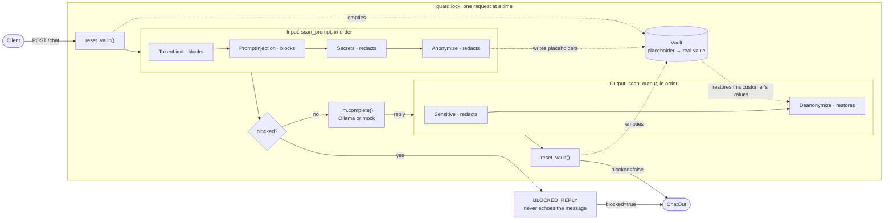

# Request flow

How a `POST /chat` request moves through the guard. Source: `api.chat()` in `src/shopar_support/api.py` and `Guard` / `build_default_guard()` in `src/shopar_support/guard.py`.

## Why it works this way

- **Every input scanner runs before the decision.** `scan_prompt` passes each scanner the text the previous one cleaned, and only afterwards `Guard` checks whether a flagged scanner is in `blocking_input`. A blocking scanner that fires too often hides how the later scanners behaved.
- **The model only sees placeholders.** `Anonymize` stores the real values in the vault and `Deanonymize` puts them back into the reply. The vault is shared state, so `api.chat()` holds `guard.lock` and empties it before and after each request: one customer's data can never be restored into another customer's reply.
- **A blocked request returns a fixed message.** The original is never echoed, because it may contain what was just redacted.
- **Output never blocks today.** `blocking_output` is empty, so output scanners only redact or restore.

## Known gaps

- `PromptInjection` uses an English-only model and blocks benign Spanish messages.
- `Secrets` is pattern-based: a key in an unknown format goes through.
- Nothing checks URLs in the reply (`MaliciousURLs` is unusable because its model was removed). See `openspec/changes/add-output-url-allowlist`.

Run `uv run python -m shopar_support.eval` (or `/attack-eval`) for current results; `evals/attacks.yaml` is the source of truth for what the guard should block.
